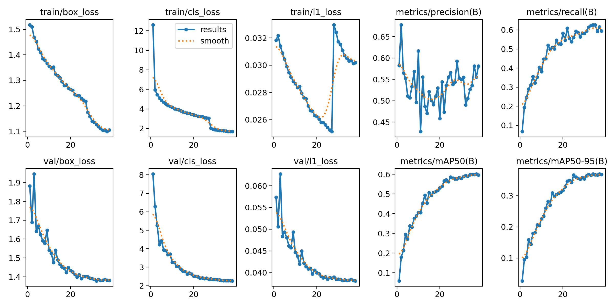
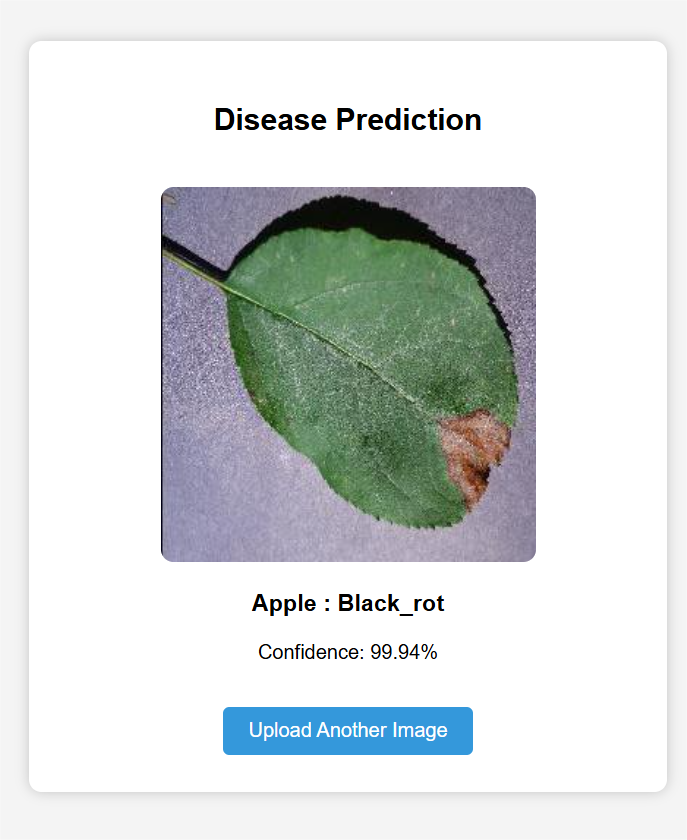
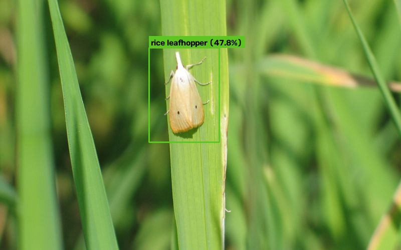

# PlantCare AI

**Deep Learning-Based Plant Disease Classification & Insect Pest Detection System**

PlantCare AI is an end-to-end computer vision web application that diagnoses **38 plant leaf diseases** and detects **102 agricultural insect pest species** from plant images. The system pairs a **MobileNetV2** transfer-learning classifier with an edge-optimized **YOLO26n** object detector exported to **LiteRT (`.tflite`)**, unified behind a **Flask** web interface with host-crop pest filtering.

---

## System Capabilities

- **Dual-Mode Visual Diagnosis:** Switch between **Leaf Disease Classification** (38 classes) and **Insect Pest Detection** (102 classes) from a single web interface.
- **Host-Crop Class Masking:** Filter pest predictions across 8 agricultural crop taxonomies (*Rice, Corn, Wheat, Beet, Alfalfa, Vitis/Grape, Citrus, Mango*) at post-processing time to eliminate cross-crop false positives.
- **Edge-Ready Quantized Inference:** Runs `w8a32`-quantized LiteRT (`~2.9 MB`) YOLO26n models with letterbox preprocessing, planar `NCHW` tensor formatting, and OpenCV Non-Maximum Suppression (NMS).
- **Visual Bounding-Box Annotations:** Renders labeled bounding boxes, species names, host crops, and per-instance confidence scores directly onto uploaded images.

---

## Datasets

### 1. Plant Disease Dataset
- **Source:** [New Plant Diseases Dataset (Augmented)](https://www.kaggle.com/datasets/vipoooool/new-plant-diseases-dataset)
- **Scale & Scope:** ~87,000 RGB leaf images across **38 plant-disease categories** covering crops such as Apple, Corn, Grape, Potato, and Tomato.
- **Example Classes:** `Apple___Apple_scab`, `Apple___Black_rot`, `Corn___Common_rust`, `Potato___Early_blight`, `Tomato___Early_blight`, `Tomato___Late_blight`.

### 2. Insect Pest Dataset (IP102 Detection Split)
- **Source:** IP102 Large-Scale Benchmark Dataset for Insect Pest Recognition (Pascal VOC XML converted to normalized YOLO format).
- **Scale & Scope:** **18,975 annotated images** across **102 pest species** organized under 8 host crops (`13,659` train / `1,518` validation / `3,798` held-out test images).
- **Host Crop Coverage:** Rice (14 classes), Corn (13), Wheat (9), Beet (8), Alfalfa (13), Vitis/Grape (12), Citrus (18), and Mango (15).

---

## Data Preprocessing & Augmentation

### Disease Classification Pipeline (`src/disease/preprocessing.py`)
- **Resizing & Normalization:** Images are resized to `224 × 224 × 3` RGB and normalized from `[0, 255]` to `[0, 1]` (`rescale = 1./255`).
- **Training Augmentation (`ImageDataGenerator`):** Random rotation (`25°`), zoom (`0.2`), shear (`0.2`), and horizontal flip.

### Pest Detection Pipeline (`src/pest/detector.py`)
- **Letterbox & Layout Conversion:** Aspect-ratio-preserving resize with `114` gray padding to `640 × 640`, normalized to `[0.0, 1.0]` `float32`, and transposed to planar `NCHW` (`(1, 3, 640, 640)`).
- **Training Augmentation:** Mosaic tiling (`1.0`, disabled for the final 10 epochs via `close_mosaic=10`), rotation (`±15°`), scale (`0.5`), horizontal/vertical flips (`0.5`), HSV color jitter, random erasing (`0.4`), and Albumentations blur/CLAHE.

---

## Model Architectures

### 1. Plant Disease Classifier (MobileNetV2)
```text
Input Image (224 × 224 × 3)
        │
        ▼
MobileNetV2 (ImageNet Pretrained Backbone)
        │
        ▼
Global Average Pooling
        │
        ▼
Dense Layer (256 units, ReLU)
        │
        ▼
Softmax Output Layer (38 Classes)
```

### 2. Insect Pest Detector (YOLO26n)
- **Backbone & Neck:** Lightweight `C3k2` blocks, `SPPF`, and `C2PSA` spatial attention (`2.41M` fused parameters, `5.5 GFLOPs`).
- **Detection Head:** Distribution-Focal-Loss-free (`l1_loss`) regression head trained with `ProgLoss + STAL` (Small-Target-Aware Label Assignment) for small field pests.
- **Deployment Exports:** Quantized `w8a32` LiteRT models at `640 × 640` (`~2.9 MB` primary) and `416 × 416` (`~2.9 MB` fast preview), outputting `(1, 106, 8400)` raw tensors for crop-masked decoding and NMS.

---

## Training Configuration & Evaluation

### Disease Model (`MobileNetV2`)
| Parameter / Metric | Value |
| :--- | :--- |
| Optimizer / Loss | Adam / Categorical Crossentropy |
| Batch Size / Epochs | `32` / `5` epochs at `224 × 224` |
| Training Accuracy | `~94%` |
| Validation Accuracy | `~91%` (Loss `~0.18`) |


### Pest Model (`YOLO26n` on IP102)
| Parameter / Metric | Value |
| :--- | :--- |
| Optimizer / Schedule | AdamW (`lr0=0.001`, `cos_lr=True`, `weight_decay=0.0005`) |
| Batch Size / Resolution | `32` / `640 × 640` (38 epochs on Tesla T4) |
| **Validation (`1,518` imgs / `1,873` instances)** | **`mAP50 = 0.599`** (`0.602` peak) · **`mAP50-95 = 0.370`** · Recall `0.631` · Precision `0.528` |
| **Held-Out Test (`3,798` imgs / `4,444` instances)** | **`mAP50 = 0.574`** · **`mAP50-95 = 0.359`** · Recall `0.599` · Precision `0.542` |



---

## Web Application & Inference Pipeline

The backend (`app.py`) routes uploaded images through `utils/predict.py` to either `src/disease/classifier.py` or `src/pest/detector.py`:

```text
User Upload (Image + Scan Mode + Optional Host Crop)
        │
        ▼
Flask Server (app.py -> utils/predict.py)
        ├──► [Leaf Disease Mode] ──► Resize (224×224) ──► MobileNetV2 (.h5) ──► Disease Label + Confidence
        │
        └──► [Insect Pest Mode]  ──► Letterbox (640×640 NCHW) ──► YOLO26n (.tflite)
                                           │
                                           ▼
                                 Crop Class Masking + OpenCV NMS
                                           │
                                           ▼
                                 Annotated Image (static/outputs/) + Detections Table
```

### Web Interface & Detection Output





---

## Project Structure

```text
PlantCareAI/
├── app.py                                                 # Flask application entry point
├── requirements.txt                                       # Python dependencies
├── README.md
│
├── data/
│   ├── processed/ip102/                                   # Converted YOLO dataset, splits & class distribution
│   └── raw/ip102/                                         # Original Pascal VOC XML annotations & images
│
├── models/
│   ├── disease/                                           # MobileNetV2 disease classifier (.h5, .tflite, labels)
│   └── pest/
│       ├── ip102_yolov26n_baseline/                       # Primary YOLO26n model, w8a32 .tflite & test metrics
│       ├── ip102_yolov8n_baseline/                        # Baseline YOLOv8n comparison run
│       └── cpu_smoke_test/                                # Initial verification run
│
├── notebook/
│   ├── pest_model_yolo26n.ipynb                           # YOLO26n IP102 training & LiteRT export notebook
│   ├── pest_model_yolov8n.ipynb                           # YOLOv8n training notebook
│   └── plantcareai-notebook.ipynb                         # MobileNetV2 disease classification notebook
│
├── scripts/
│   └── pest_prep/                                         # Dataset conversion, box validation & audit scripts
│
├── src/
│   ├── advisory/                                          # Agronomic guidance module
│   ├── disease/                                           # Leaf disease preprocessing & inference
│   └── pest/                                              # YOLO26n LiteRT detector, NMS & crop-pest taxonomy map
│
├── static/
│   ├── outputs/                                           # Annotated pest outputs & evaluation plots
│   └── uploads/                                           # User-uploaded images
│
├── templates/
│   ├── index.html                                         # Mode-aware upload UI with host-crop filter
│   └── result.html                                        # Prediction & multi-pest bounding-box results view
│
└── utils/
    └── predict.py                                         # Unified disease/pest prediction router
```

---

## Running the Project

1. **Clone the repository:**
   ```bash
   git clone <repository-url>
   cd PlantCareAI
   ```

2. **Create and activate a virtual environment:**
   ```bash
   python -m venv .venv
   # Windows PowerShell:
   .venv\Scripts\Activate.ps1
   ```

3. **Install dependencies:**
   ```bash
   pip install -r requirements.txt
   ```

4. **Start the Flask server:**
   ```bash
   python app.py
   ```
   Open `http://127.0.0.1:5000` in your browser.

---

## Example Outputs

- **Leaf Disease Mode (`Tomato leaf image`):**
  ```text
  Tomato : Early Blight
  Top Confidence: 94.3%
  ```

- **Insect Pest Mode (`Rice field sample, Host Crop = Rice`):**
  ```text
  Rice : Rice Leaf Roller
  Top Confidence: 87.9%
  BBox [x1, y1, x2, y2]: 112, 84, 346, 291
  ```

---

## Technologies Used

- **Deep Learning & Edge Inference:** TensorFlow / Keras, LiteRT (`.tflite`), PyTorch, Ultralytics YOLO26
- **Computer Vision & Data Processing:** OpenCV, NumPy, Pillow
- **Web Backend & Frontend:** Flask, HTML5, CSS3, JavaScript

---

## License

This project is for educational and research purposes.
