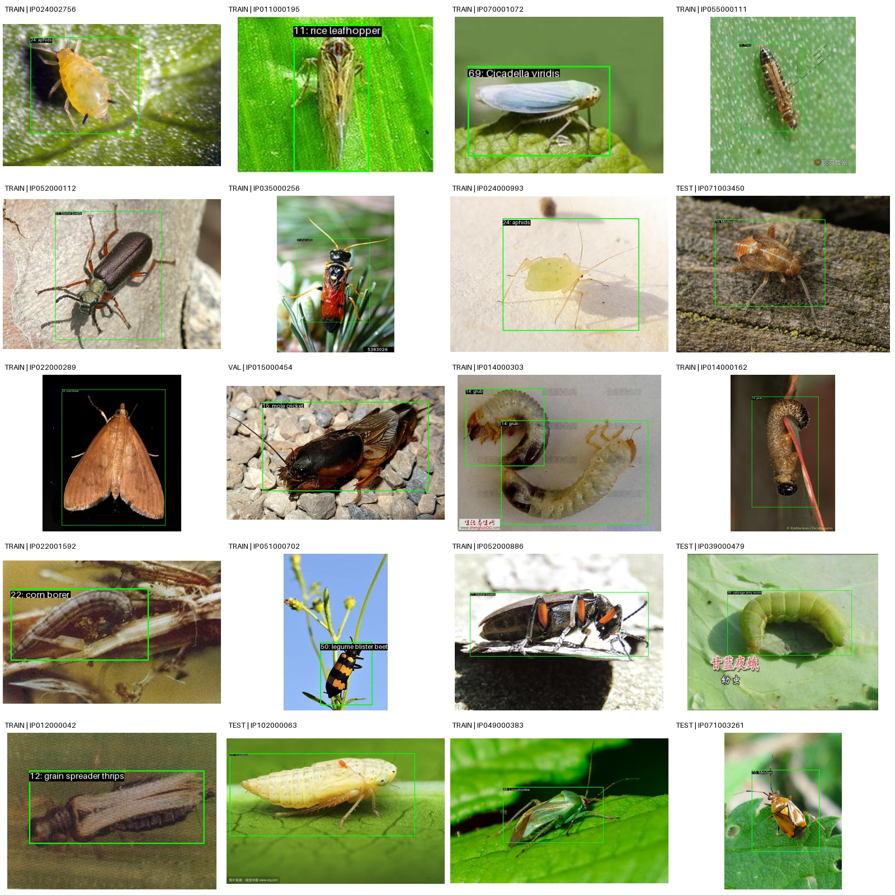
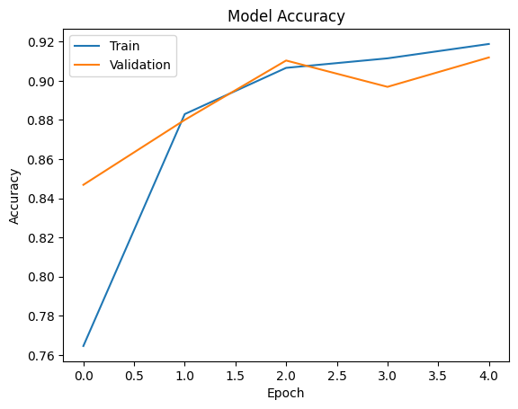
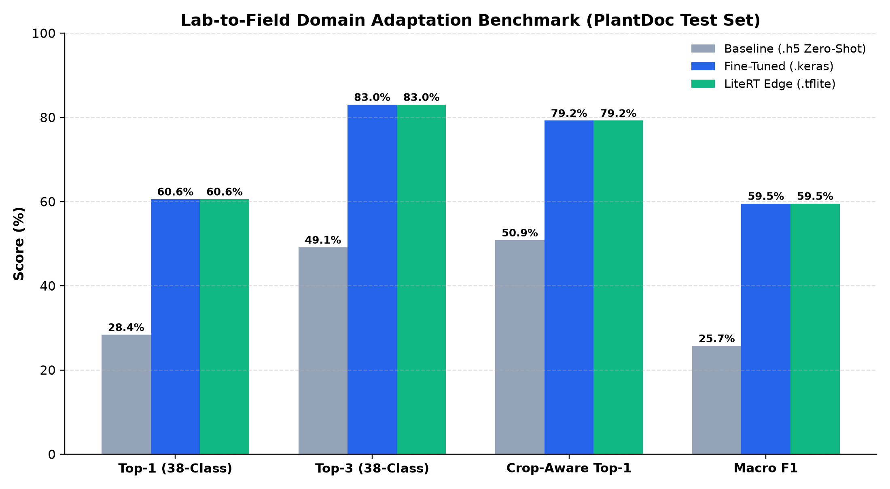

# PlantCareAI

PlantCareAI combines **leaf disease classification, insect pest detection, and an offline crop advisory pilot**. The Flask app runs the vision models locally. The Android prototype uses Llama 3.2 1B through ExecuTorch, with SQLite supplying source-backed guidance for the tomato and maize pilot.

| Component | Scope | Status |
| --- | --- | --- |
| Leaf disease classification | MobileNetV2 with 38 disease and healthy labels across 14 crop groups | Flask inference with the field-fine-tuned Keras model. A LiteRT export is available for edge deployment. |
| Insect pest detection | YOLO26n LiteRT with 102 IP102 class IDs, host-crop filtering, and bounding boxes | Flask inference. Android pest integration and validation of the shipped detector are pending. |
| Crop advisory | English/Hindi reference content, regional filtering, signs, risk factors, and mitigation | Stage 1B SQLite lookup and the two-crop Python pilot are available. |
| On-device LLM | Llama 3.2 1B Instruct, INT4, ExecuTorch/XNNPACK | Native inference has been demonstrated on Android. The full scan-to-advisory flow with validated Llama topic routing is pending. |

## Contents

- [Demo images](#demo-images)
- [Quick start](#quick-start)
- [Offline advisory and Llama](#offline-advisory-and-llama)
- [Vision pipelines](#vision-pipelines)
- [Datasets](#datasets)
- [Training and evaluation](#training-and-evaluation)
- [Repository layout](#repository-layout)
- [Usage and licensing](#usage-and-licensing)

## Demo images

### Crop disease classification


### Insect pest detection



## Quick start

### Run the Flask vision app

From PowerShell:

```powershell
git clone https://github.com/KUSH2005-IND/PlantCareAI.git
cd PlantCareAI
python -m venv .venv
.\.venv\Scripts\Activate.ps1
python -m pip install -r requirements.txt
python -m pip install opencv-python
python app.py
```

Open <http://127.0.0.1:5000>. Choose **Leaf Disease** or **Insect Pest**, select the host crop when known, and upload an image. The detector imports `cv2`, so install OpenCV if it is absent from your checkout's dependencies.

The current Flask loaders expect these paths:

| Mode | Required files |
| --- | --- |
| Leaf disease | `models/disease/disease_finetuned.keras` |
| Insect pest | `models/pest/ip102_yolov26n_baseline/yolo26n_ip102_640_raw_w8a32.tflite` and `models/pest/ip102_yolov26n_baseline/ip102_labels.json` |

Check the paths in the [classifier](src/disease/classifier.py) and [detector](src/pest/detector.py) if your checkout contains differently named exports. Pair the detector with its matching metadata and use its expected input/output layout.

### Try the offline advisory on a desktop

Run from the repository root. Both commands use Python's standard library and the bundled Stage 1B database.

```powershell
$db = ".\scripts\llm_advisory\plantcare_knowledge_stage1b.db"
python .\scripts\llm_advisory\plantcare_llm_two_crop.py --db $db --self-test
python .\scripts\llm_advisory\plantcare_advisory.py --db $db --class-id 8 --region IN-TN --question "Will it spread, and what should I do?"
```

The example uses maize common rust, zero-based class `8`. It returns **risk** and **mitigation** records with source information. In the supplied Stage 1B snapshot, those records have general applicability even when Tamil Nadu is selected. Use `--lang hi` with a supported Hindi query, or pass an explicit topic such as `--topic signs`.

## Offline advisory and Llama

### What the advisory does

The read-only **Stage 1B SQLite** database links a crop and model class to advisory records, eligible regions, localized text, and source metadata. The initial disease advisory scope is:

| Crop | Zero-based class IDs in the pilot |
| --- | --- |
| Maize | `8` common rust, `9` northern leaf blight, `10` healthy |
| Tomato | `28` bacterial spot, `29` early blight, `30` late blight, `37` healthy |

- **Signs** cover what to look for and possible look-alikes where documented.
- **Risk** describes conditions that can favour a problem. Dated forecasts need a separate data source.
- **Mitigation** covers eligible monitoring, prevention, management, and when to seek help. The pilot does not supply verified fertilizer or pesticide rates.
- **Regional filtering** uses location independently of language. State-specific guidance appears only where eligible. General and India-wide records are identified by scope.
- **Languages** include English and Hindi reference text, with review status preserved. Additional localized guidance requires a reviewed content pack. Android interface localization and advisory text coverage are separate.
- **Pest guidance** is in developer preview until the exact mobile export, class mapping, and relevant detections are validated. Species-specific actions require sufficient identification.

### Model and device setup

| Item | Details |
| --- | --- |
| Base checkpoint | Meta Llama 3.2 1B Instruct |
| Export | `llama3_2_1b_m33_xnnpack_int4_g32_seq512.pte` |
| Runtime | ExecuTorch with the XNNPACK CPU backend |
| Quantization | `8da4w` post-training quantization with 8-bit dynamic activations, 4-bit linear weights, group size 32, and 4-bit embeddings |
| Exported context | 512 total tokens |
| Model size | Approximately 820 MiB |
| Provisioning | Copy the `.pte` and its matching tokenizer to the device and import them through the Android prototype's local model setup. Obtain the `.pte` from the project team. Git excludes this export. |

Use the tokenizer supplied with the exact export. Short native Llama generation has been demonstrated on the Samsung Galaxy M33 and in the Android prototype on Vivo. The deployment workflow is designed for local inference after provisioning.

### How Llama fits into the app

The Android integration target is **scan context + follow-up question → Llama topic routing → eligible SQLite records → localized answer with sources**. Llama can propose one or more topics, such as `TOPICS:RISK,MITIGATION`. Kotlin validates the response and retrieves the corresponding stored records. Explicit topic buttons provide a direct lookup path if the model cannot resolve the question.

The desktop advisory CLI uses rules or explicit topics. It does not execute the `.pte`. The two-crop reference can also prepare an earlier action-ID prompt, which is a separate experiment. The Android release handoff includes a topic-routing benchmark for English and Hindi. The benchmark still needs a run through the integrated mobile runtime. On-device generation alone does not validate advisory accuracy.

## Vision pipelines

### Leaf disease classification

The Flask path uses `disease_finetuned.keras`, a MobileNetV2 model adapted from PlantVillage to PlantDoc. It takes the central 85% of the image, resizes to `224 × 224`, scales RGB pixels to `[0, 1]`, and predicts across 38 labels. When the crop is supplied, the classifier masks and renormalizes scores to that crop's supported classes.

```text
Image → center crop → RGB 224 × 224 NHWC → MobileNetV2 → crop-conditioned label and score
```

The model uses global average pooling, a 256-unit ReLU layer, and a 38-class softmax. The Android prototype uses a LiteRT classifier and an independent visible-damage heuristic.

### Insect pest detection

The Flask detector uses a YOLO26n LiteRT export and IP102 metadata. It letterboxes the image to `640 × 640` using gray padding, converts it to normalized RGB planar `NCHW`, decodes raw candidate boxes and class scores, filters the selected host crop, and applies OpenCV NMS. It maps boxes back to the original image and produces an annotated result.

```text
Image → 640 × 640 letterbox → YOLO26n LiteRT → crop filter and NMS → boxes and labels
```

The raw decoder expects four box values and scores for 102 class IDs per candidate. For a different export, inspect the real tensor signature and confirm whether suppression is already built into the model. Classifier and detector scores reflect model output and should be interpreted with the image and crop context.

## Datasets

| Dataset | Role | Coverage |
| --- | --- | --- |
| [New Plant Diseases Dataset (Augmented / PlantVillage)](https://www.kaggle.com/datasets/vipoooool/new-plant-diseases-dataset) | Leaf classifier pretraining | Approximately 87,000 RGB images across 38 disease and healthy classes. |
| [PlantDoc](https://github.com/pratikkayal/PlantDoc-Dataset) | Field adaptation and evaluation | Field images with 27 mapped classes in the checked-in evaluation. |
| IP102 detection split | Pest detector training and held-out evaluation | 18,975 images after VOC-to-YOLO conversion: 13,659 train, 1,518 validation, and 3,798 test. The nominal taxonomy has 102 IDs, with 97 represented in the converted annotations. |

IP102 host groups are rice, maize, wheat, beet, alfalfa, grape, citrus, and mango. Datasets and large training checkpoints are provisioned separately where needed.

## Training and evaluation

### Disease classification

The training pipeline starts from a PlantVillage MobileNetV2 checkpoint. On PlantDoc it warms up the classifier head for three epochs with Adam at `3e-4` and label smoothing `0.1`, then fine-tunes the upper backbone for ten epochs at `5e-5` with batch normalization frozen. Field augmentation includes flips, rotation, zoom, contrast variation, and random crops.

The [checked-in PlantDoc report](runs/disease/eval_plantdoc/metrics_summary.json) covers **472 test images across 27 evaluated classes**.

| Model | Top-1 accuracy | Crop-aware accuracy |
| --- | ---: | ---: |
| PlantVillage checkpoint, zero-shot | 28.39% | 50.85% |
| PlantDoc fine-tuned Keras | 60.59% | 79.24% |
| Edge LiteRT export | 60.59% | 79.24% |





To rerun the evaluation, provision the baseline `plant_disease_model.h5`, the fine-tuned model and LiteRT export, and `data/PlantDoc-Dataset/test`. Run `python scripts/crop_disease_prep/eval_disease_metric.py` after installing the evaluation dependencies, including Matplotlib.

### Pest detection

The supplied YOLO26n run used AdamW, cosine scheduling, `640 × 640` inputs, a batch size of 32, and 38 epochs on a Tesla T4. Training augmentation included mosaic, rotation, scale, flips, HSV variation, and random erasing.

| Split | Images | Instances | mAP50 | mAP50–95 | Precision | Recall |
| --- | ---: | ---: | ---: | ---: | ---: | ---: |
| Validation | 1,518 | 1,873 | 0.599 | 0.370 | 0.528 | 0.631 |
| Held-out test | 3,798 | 4,444 | 0.574 | 0.359 | 0.542 | 0.599 |

These are reported offline training and evaluation results. Android speed and per-class detection performance need device-level validation of the shipped export. See the [YOLO26n notebook](notebook/pest_model_yolo26n.ipynb) for the training workflow.

#### Pest evaluation visuals


### Example outputs

- **Leaf disease** · Tomato early blight, crop-conditioned score 78.4%.
- **Insect pest** · Corn borer, score 86.2%, box `[118, 92, 341, 284]`.

These are illustrative outputs from the project documentation.

## Repository layout

```text
PlantCareAI/
├── app.py                         # Flask entry point
├── requirements.txt
├── models/
│   ├── disease/                   # Keras and LiteRT exports
│   ├── pest/                      # YOLO26n assets and experiment artifacts
│   └── llm/                       # Local LLM assets (.pte provisioned separately)
├── notebook/                      # Training and export notebooks
├── runs/                          # Evaluation reports and plots
├── scripts/
│   ├── crop_disease_prep/         # PlantDoc fine-tuning and evaluation
│   ├── pest_prep/                 # IP102 conversion and validation
│   └── llm_advisory/
│       ├── plantcare_advisory.py
│       ├── plantcare_llm_two_crop.py
│       ├── plantcare_llm_pilot_final.py
│       └── plantcare_knowledge_stage1b.db
├── src/
│   ├── disease/classifier.py
│   └── pest/detector.py
├── static/
├── templates/
└── utils/predict.py
```

**Stack:** Flask, TensorFlow/Keras, LiteRT, PyTorch, Ultralytics YOLO26n, OpenCV, NumPy, Pillow, and SQLite. The Android prototype uses Kotlin, Jetpack Compose, and ExecuTorch.

## Usage and licensing

PlantCareAI is an educational and research prototype. Follow the applicable terms for the datasets and model weights. See the [Llama 3.2 license](https://github.com/meta-llama/llama-models/blob/main/models/llama3_2/LICENSE) when provisioning or redistributing the local Llama model.
